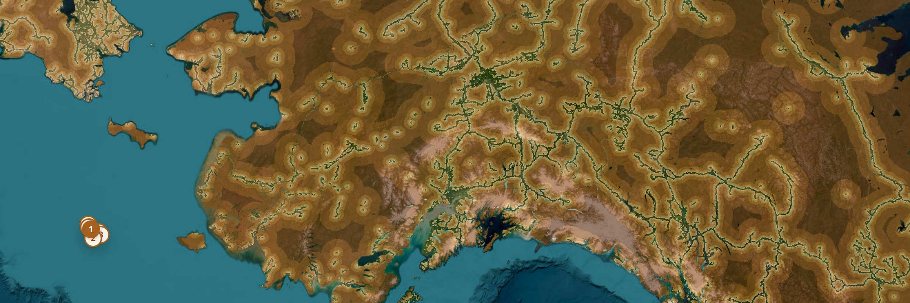

Engineering manager bringing AI into engineering. 14 years across data and engineering.

I build with a personal software factory - agents write all the code, my job is direction and verification through evals and adversarial review loops.

[**Poles of remoteness**](https://polesofremoteness.com) is an interactive map of the places farthest from any road in Europe and North America, computed from OpenStreetMap data ([source](https://github.com/donataskasp/poles-of-remoteness)).

Most of my factory output lives in private repos.

[LinkedIn](https://www.linkedin.com/in/donataskasparavicius) · [polesofremoteness.com](https://polesofremoteness.com)
